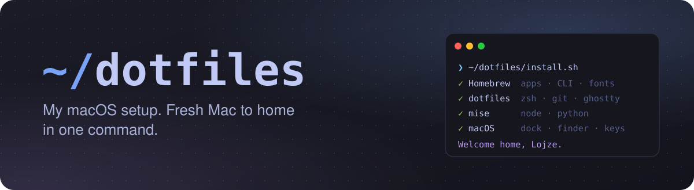
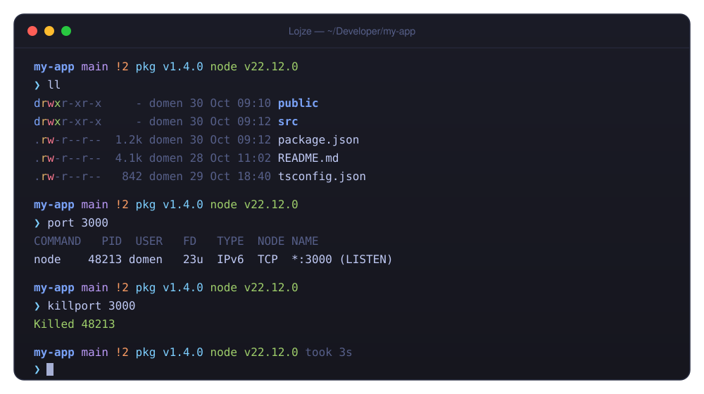
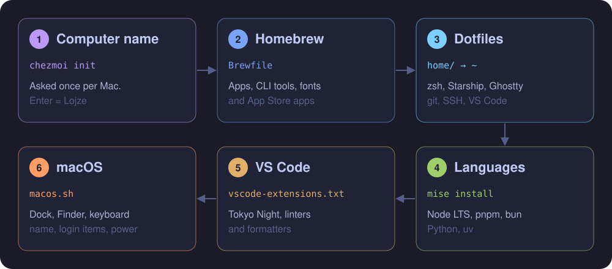
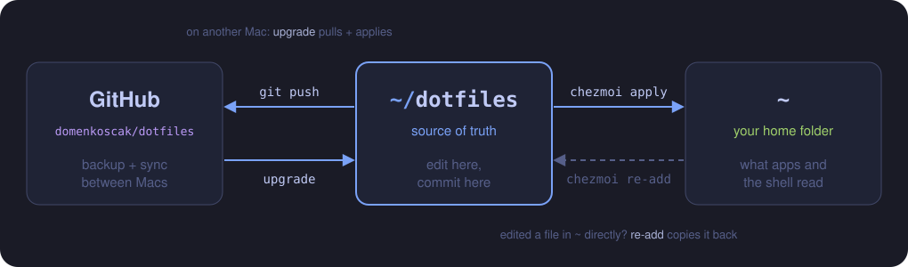

<p align="center">
  
</p>

<p align="center">
  
  
  
  
  
</p>

<p align="center">
  <a href="#new-mac">New Mac</a> ·
  <a href="#day-to-day">Day to day</a> ·
  <a href="#whats-inside">What's inside</a> ·
  <a href="#shortcuts">Shortcuts</a> ·
  <a href="#existing-mac">Existing Mac</a> ·
  <a href="#layout">Layout</a>
</p>

---

<p align="center">
  
</p>

<a id="whats-inside"></a>

## ✨ What's inside

| | |
| --- | --- |
| 🐚 **Shell** | zsh with autosuggestions, syntax highlighting, fzf-tab. `eza`, `bat`, `zoxide`, `fzf`, `fd`, `ripgrep`. Starts fast by caching tool setup. |
| ❯ **Prompt** | Starship, two lines: folder, git branch and status, package version, Node, Python, AWS profile, command duration. |
| 👻 **Terminal** | Ghostty, Tokyo Night, JetBrains Mono, translucent. Drop-down quick terminal on **Ctrl+\`**. |
| 🔐 **Git** | Commits signed with an SSH key in 1Password. Work email by default, personal email under `~/Documents/Personal`. |
| 📦 **Languages** | mise: Node LTS, pnpm, bun, Python. uv from Homebrew. Projects can pin their own versions. |
| 🧑‍💻 **VS Code** | Tokyo Night, format on save, file nesting, Ghostty-style terminal, 10 extensions. |
| 🧊 **3D / CAD** | FreeCAD with an MCP addon so Claude can model in it, `newpart` for build123d code-CAD, Bambu Studio for printing. |
| 🍎 **macOS** | Dock, Finder, keyboard, screenshots, dark mode, Touch ID for `sudo`, login items, computer name. |
| 🍺 **Apps** | Everything in the [`Brewfile`](Brewfile), including App Store apps. |

---

<a id="new-mac"></a>

## 🚀 New Mac

Takes about 30–60 minutes, mostly downloads (Xcode alone is ~10 GB).

<p align="center">
  
</p>

### 1. Before you start

- [ ] Finish macOS setup and sign in with your Apple ID.
- [ ] Open the **App Store** and sign in (needed for Xcode, Transporter, DevCleaner, Numbers).
- [ ] Run Software Update.

### 2. Get the repo

Install the Command Line Tools, which include `git` (wait for the dialog to finish):

```bash
xcode-select --install
```

Clone (the repo is public, so no GitHub login needed):

```bash
git clone https://github.com/domenkoscak/dotfiles.git ~/dotfiles
```

### 3. Run the installer

```bash
~/dotfiles/install.sh
```

1. **Computer name**: press Enter for `Lojze`, or type another (e.g. `Kosobrin` on the server).
2. **Homebrew** installs everything in the `Brewfile`. This is the long part.
3. **Dotfiles** are written to `~`.
4. **mise** installs Node, pnpm, bun, Python.
5. **VS Code** extensions install.
6. **macOS settings** apply. It asks for your **password** once.

> [!TIP]
> macOS pops up a few questions on the way. Say yes to **"Terminal wants to control System Events"**
> (dark mode, login items) and click **Use Dia** for the default browser.

> [!NOTE]
> If something fails halfway, fix the cause and run `chezmoi apply`. It picks up where it left off.

### 4. After the installer

- [ ] **1Password**: sign in, then **Settings → Developer → Use the SSH agent**.
      Signed commits and SSH pushes need this.
- [ ] Check it works. It should greet you by username:

  ```bash
  ssh -T git@github.com
  ```

- [ ] Switch the repo to SSH so pushes go through 1Password:

  ```bash
  git -C ~/dotfiles remote set-url origin git@github.com:domenkoscak/dotfiles.git
  ```

- [ ] **Log out and back in** (keyboard repeat needs it).
- [ ] **Ghostty**: press **Ctrl+\`** once and allow Accessibility for the quick terminal.
- [ ] **Raycast**: set its hotkey to **Cmd+Space** (Spotlight's is already freed).
- [ ] Sign in to Figma, Discord, Claude, Logi Options+, Stats, Bambu Studio, OrbStack.
- [ ] **FreeCAD**: open it once. The MCP addon starts its server by itself; Claude can drive FreeCAD
      whenever it's open (check with `claude mcp list`).

🎉 Done. Welcome home.

---

<a id="day-to-day"></a>

## 🔄 Day to day

<p align="center">
  
</p>

| Command | What it does |
| --- | --- |
| `upgrade` | Pull the repo and apply it, then upgrade brew, mise tools and App Store apps |
| `dotfiles` | `cd ~/dotfiles` |
| `chezmoi diff` | Show what `apply` would change |
| `chezmoi apply` | Write the repo's files into `~` and rerun scripts whose inputs changed |
| `chezmoi edit ~/.zshrc` | Edit the repo copy of a file |
| `chezmoi re-add` | Edited a file in `~` directly? Copy it back into the repo |

### Changing something

1. Edit in `~/dotfiles` (see [Layout](#layout)).
2. `chezmoi apply`
3. Commit and push:

   ```bash
   git -C ~/dotfiles add -A && git -C ~/dotfiles commit -m "Describe the change" && git -C ~/dotfiles push
   ```

4. On your other Macs: `upgrade`.

### Recipes

| I want to… | Do this |
| --- | --- |
| Add an app or CLI tool | Add `cask "name"` or `brew "name"` to `Brewfile` (find names with `brew search`), then `chezmoi apply` |
| Remove an app | Delete its line, then `brew uninstall --cask name` (`brew bundle` never removes) |
| Add a VS Code extension | Add its ID to `vscode-extensions.txt` (right-click extension → Copy Extension ID) |
| Change a macOS setting | Edit `macos.sh`; it reruns on the next `chezmoi apply` |
| Change the global Node/Python | Edit `home/dot_config/mise/config.toml`, e.g. `node = "24"` |
| Pin a version in one project | `mise use node@22` inside the project |
| Add an alias or function | Edit `home/dot_zshrc`, then `chezmoi apply && exec zsh` |

---

<a id="shortcuts"></a>

## ⌨️ Shortcuts & commands

<table>
<tr><th>Ghostty</th><th>Shell</th></tr>
<tr valign="top"><td>

| Keys | Does |
| --- | --- |
| **Ctrl+\`** | Quick terminal from anywhere |
| **Cmd+D** | Split right |
| **Cmd+Shift+D** | Split down |
| **Cmd+[** / **Cmd+]** | Previous / next split |
| **Cmd+Shift+Enter** | Zoom split |
| **Option+←/→** | Jump word |
| **Cmd+←/→** | Line start / end |
| **Cmd+Backspace** | Delete line |

</td><td>

| Command | Does |
| --- | --- |
| `z foo` | Jump to a folder you've visited |
| **Ctrl+R** / **Ctrl+T** | Fuzzy history / files |
| `git ` + **↑** | Only matching history |
| `mkcd dir` | Make a folder and enter it |
| `port 3000` | What's listening on a port |
| `killport 3000` | Stop it |
| `extract file.zip` | Unpack any archive |
| `cleanup` | Free disk space |
| `dsclean` | Delete `.DS_Store` files here |
| `newpart name` | New build123d 3D-print project, opened in VS Code |

</td></tr>
</table>

---

<a id="the-family"></a>

## 🏠 The family

| Name | Device | |
| --- | --- | --- |
| **Lojze** | MacBook | main machine, this setup |
| **Kosobrin** | MacBook Air M1 | the wise old server |
| **Rožle** | Pixel 10 | Kekec's quick sidekick, in your pocket |
| **Polde** | 3D printer | the turtle 🐢 |
| **Bine** | Bambu Lab X2D | the fast one |

---

<a id="existing-mac"></a>
<details>
<summary><h2>💻 Existing Mac (first time)</h2></summary>

For a Mac that's already in use. chezmoi **overwrites** files and doesn't keep copies, so back up first:

```bash
mkdir -p ~/dotfiles-backup && cp -R ~/.zshrc ~/.zprofile ~/.config/starship.toml ~/.config/ghostty ~/.config/git ~/.ssh/config "$HOME/Library/Application Support/Code/User/settings.json" ~/dotfiles-backup/
```

Point chezmoi at the repo (asks for the computer name):

```bash
chezmoi init --source ~/dotfiles
```

See what would change (`q` to quit):

```bash
chezmoi diff
```

Close VS Code, then apply:

```bash
chezmoi apply
```

Then do the [After the installer](#4-after-the-installer) steps that aren't done yet.

> [!WARNING]
> - **Node and Python switch to mise.** Projects that need a specific Node version should have a
>   `.nvmrc` or `mise.toml`. Global npm packages installed with Homebrew's Node won't be on PATH anymore.
> - **Git email** becomes `domen.koscak@zerodays.dev` everywhere except `~/Documents/Personal`.
> - **The Mac gets renamed**, and the Dock is rebuilt.

</details>

<a id="rolling-back"></a>
<details>
<summary><h2>⏪ Rolling back</h2></summary>

- **One file:** copy it back from `~/dotfiles-backup/`.
- **An earlier version:** `git -C ~/dotfiles log`, then
  `git -C ~/dotfiles checkout <commit> -- <path>` and `chezmoi apply`.
- **macOS settings:** there's no undo script; change them back in System Settings.

</details>

---

<a id="layout"></a>

## 🗂 Layout

```
Brewfile                 Homebrew formulae, casks, App Store apps
vscode-extensions.txt    VS Code extensions
macos.sh                 System settings (Dock, Finder, keyboard, power, name, login items)
install.sh               Bootstrap for a fresh Mac
assets/                  Images for this README
home/                    Everything chezmoi puts in ~ (see .chezmoiroot)
├── .chezmoi.toml.tmpl            chezmoi config; asks for the computer name
├── .chezmoiexternal.toml         fzf-tab plugin, bat Tokyo Night theme
├── dot_zshrc, dot_zprofile       zsh
├── dot_config/
│   ├── starship.toml             prompt
│   ├── ghostty/config            terminal
│   ├── git/                      git config, signing, personal override
│   ├── build123d/part.py         starter part for `newpart`
│   └── mise/config.toml          node, pnpm, bun, python
├── private_dot_ssh/              SSH config for the 1Password agent (public key only)
├── Library/…/Code/User/          VS Code settings
├── Library/…/FreeCAD/            FreeCAD MCP addon auto-start setting
└── run_*                         brew bundle, mise install, VS Code extensions, Claude MCP servers, macos.sh
```

The `run_onchange_*` scripts rerun automatically when `Brewfile`, `vscode-extensions.txt`,
`macos.sh`, the mise config or the computer name change.
